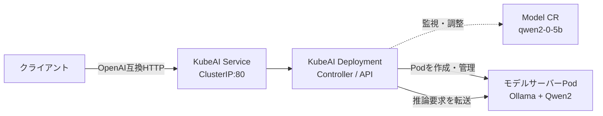
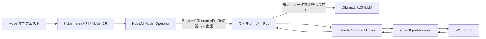

# KubeAIのインストールとCPU推論

## 概要

KubeAIはKubernetes上で機械学習モデルを提供する推論オペレーターである。Kubernetes独自リソース`Model`にモデルのエンジン、モデルURL、必要な機能、リソースプロファイルなどを定義すると、KubeAIがモデルサーバーPodのライフサイクルを管理する。

この実習では、Docker Desktop KubernetesにKubeAI 0.25.0をインストールし、Ollamaで小さなQwen2モデルをCPU実行した。GPU/CUDAは使用していない。

## 必要性

モデルごとのDeploymentやServiceを手作業で組み立てる代わりに、KubeAIの`Model`リソースで推論モデルの望む状態を宣言できる。KubeAIがその状態を監視してモデルサーバーを用意し、共通のOpenAI互換APIから呼び出せる。

## 仕組み



KubeAIの公式資料では、モデルサーバーPodはKubeAIコントローラーが管理し、各Podは起動時に1つのモデルをロードする。`Model`は`kubeai.org/v1` APIグループのカスタムリソースである。

## 実習環境とバージョン

- Windows 11 / WSL2 Ubuntu
- Docker Desktop Kubernetes: v1.36.1、1ノード
- Helm: v4.3.1（Snap経由でUbuntuに導入）
- KubeAI Chart / アプリ: 0.25.0
- CPUモデル: Ollama `qwen2:0.5b`
- Docker Desktopがコンテナに見せるメモリ: 約14.52 GiB（事前に`docker info`で確認）

公式のKubeAI互換性資料では現行の開発・CI対象はKubernetes v1.37である。今回のv1.36.1はテスト対象として明記されておらず、動作保証の範囲外である。Chartメタデータには`kubeVersion`制約がなかったため、学習目的でインストールしている。

## 実習

### Helm Chartの確認

```bash
helm repo add kubeai https://www.kubeai.org
helm repo update
helm search repo kubeai --versions
helm show chart kubeai/kubeai --version 0.25.0
helm show values kubeai/kubeai --version 0.25.0
```

Chart既定値ではOpen WebUIが有効で、StatefulSetとPVCも作られることを`helm template`で確認した。最初はKubeAI本体に集中するため、インストール時にOpen WebUIを無効化した。

```bash
helm template kubeai kubeai/kubeai --version 0.25.0 --namespace kubeai \
  --set open-webui.enabled=false | grep -E '^(kind:|  name:)'
```

### KubeAIのインストール

```bash
helm install kubeai kubeai/kubeai \
  --version 0.25.0 \
  --namespace kubeai \
  --create-namespace \
  --set open-webui.enabled=false \
  --wait \
  --timeout 10m
```

結果は`STATUS: deployed`、`DESCRIPTION: Install complete`だった。`kubeai` NamespaceにKubeAI DeploymentとServiceが作成され、CRD `models.kubeai.org`が登録された。

```bash
kubectl get deployments,pods,services -n kubeai
kubectl get crd models.kubeai.org
```

KubeAI本体は`1/1 Running`、Serviceは`ClusterIP`、CRDは存在した。最初はModelリソースがなかった。

### Modelリソース

`kubernetes/manifests/kubeai-qwen2.yaml`:

```yaml
apiVersion: kubeai.org/v1
kind: Model
metadata:
  name: qwen2-0-5b
  namespace: kubeai
spec:
  features:
    - TextGeneration
  url: ollama://qwen2:0.5b
  engine: OLlama
  resourceProfile: cpu:1
  minReplicas: 1
```

適用コマンド:

```bash
kubectl apply -f /mnt/c/Users/sugan/OneDrive/Documents/GitHub/ai-infrastructure-lab/kubernetes/manifests/kubeai-qwen2.yaml
```

適用結果は`model.kubeai.org/qwen2-0-5b created`。KubeAIはモデルPodを作成し、Podは一時`ContainerCreating`になった後、`1/1 Running`になった。初回はOllamaのコンテナイメージとモデルデータを取得した。Ollama公式ライブラリの表示では`qwen2:0.5b`は352MB。

```bash
kubectl get models,pods -n kubeai
kubectl get model qwen2-0-5b -n kubeai -o yaml
kubectl describe pod model-qwen2-0-5b-5c7c4d4576-lpwkb -n kubeai
```

Modelの`status.replicas.all`と`status.replicas.ready`はそれぞれ1だった。`spec`には`replicas: 1`、`targetRequests: 100`、`scaleDownDelaySeconds: 30`など、最初に適用したマニフェストにない既定・管理値も現れた。

### OpenAI互換API

別ターミナルでKubeAI Serviceへポートフォワードした。

```bash
kubectl port-forward service/kubeai 8000:80 -n kubeai
```

出力は以下だった。Serviceのポート80からPodのtarget port 8000へ転送されている。

```text
Forwarding from 127.0.0.1:8000 -> 8000
Forwarding from [::1]:8000 -> 8000
```

モデル一覧:

```bash
curl http://localhost:8000/openai/v1/models
```

結果:

```json
{"object":"list","data":[{"id":"qwen2-0-5b","created":1793768496,"object":"model","owned_by":"","features":["TextGeneration"]}]}
```

チャット補完:

```bash
curl -sS http://localhost:8000/openai/v1/chat/completions \
  -H 'Content-Type: application/json' \
  -d '{"model":"qwen2-0-5b","messages":[{"role":"user","content":"日本語で一文だけ、KubernetesのPodを説明してください。"}],"max_tokens":64,"stream":false}'
```

HTTPリクエストに対して`chat.completion`のJSON応答が返り、`system_fingerprint`は`fp_ollama`、`finish_reason`は`stop`だった。
実際の`message.content`は次のとおりだった。

```text
日本語では、KubernetesのPodはContainer Processing Systemの略。
```

## 実行結果と気づき

- KubeAI本体のPodと、推論を実行するモデルサーバーPodは別々に作成された。
- `kubectl get pods -n kubeai -o wide`では、KubeAI Podが`10.244.0.7`、モデルPodが`10.244.0.6`で、両方ともNode `desktop-control-plane`上にあった。Pod IPはクラスター内のアドレスである。
- KubeAI公式のArchitecture資料によると、Model Proxy（OpenAI互換API）とModel Operator（Model CRを監視しバックエンドPodを管理）は同じDeployment内に配置される。この環境では`kubeai-774785c58c-ltxc7`がそのPodである。
- `model-qwen2-0-5b-5c7c4d4576-lpwkb`はモデルサーバーPodで、Ollamaが`qwen2:0.5b`を読み込み、CPUで推論する。KubeAIは`Model` CRに基づいてPodを作り、そのライフサイクルを管理する。
- `kubectl describe pod`で`Controlled By: Model/qwen2-0-5b`と表示され、Modelリソースが推論Podを所有していることを確認した。コンテナイメージは`ollama/ollama:0.11.11`、ポートは8000/TCP、resource requestsはCPU 1、メモリ2Giだった。
- Startup probeにはOllamaの`pull`、モデル名の`cp`、`run`が設定されていた。Eventsではノードへのスケジュール、約1.8GBのOllamaコンテナイメージの取得、コンテナ作成・開始を確認した。
- `Model`リソースを適用すると、KubeAIがモデルPodを調整し、Ready状態にした。
- KubeAI ServiceはOpenAI互換APIの入口として動作し、ポートフォワードでWSLから呼び出せた。
- `Running`やAPI応答の成功は、モデルの回答が正しいことを保証しない。今回、モデルは「PodはContainer Processing Systemの略」と回答したが、これは誤り。KubernetesのPodは1つ以上のコンテナをまとめる最小のデプロイ単位であり、その語は略語ではない。
- API疎通確認と、生成内容の事実確認は別の検証である。
- Kubernetes APIへの一時的な接続拒否が発生した後、Docker DesktopのKubernetesが復旧し、Nodeは`Ready`に戻った。`kubectl get nodes`で接続を切り分けてからモデルPodの確認を再開した。

## 0台からのスケールアップ

マニフェストの`minReplicas`を1から0に変更し、再適用した。

```bash
kubectl apply -f /mnt/c/Users/sugan/OneDrive/Documents/GitHub/ai-infrastructure-lab/kubernetes/manifests/kubeai-qwen2.yaml
kubectl get model qwen2-0-5b -n kubeai -o yaml
kubectl get pods -n kubeai
```

Modelは残ったまま`spec.minReplicas: 0`、`spec.replicas: 0`、`status.replicas.all: 0`、`ready: 0`となり、Pod一覧にはKubeAI本体だけが残った。

その状態でチャット補完APIにリクエストを送ると、新しいモデルPodが作成された。

```bash
kubectl get pods -n kubeai --watch
```

観測した状態遷移:

```text
Pending
ContainerCreating
Running 0/1
Running 1/1
```

Podが`1/1 Running`になった後、APIから`1+1は2です。`という応答が返った。これはKubeAIがリクエスト時に0台からモデルPodを起動し、Ready後に推論要求を転送した実測である。今回の観測ではPodは約40秒でReadyになった。

KubeAI公式のAutoscaling資料によると、モデルPodが0台のときにリクエストが届くと、KubeAIは要求を保持してPodを起動し、Readyになってからバックエンドへ転送する。したがって0台からの起動中は、API応答までにコールドスタートの待ち時間が加わる。今回の実習ではPodの状態遷移と、その後の応答を確認した。

後日`qwen25-0-5b-vllm`のModel YAMLを確認したときは、`minReplicas: 0`に加えて`spec.replicas: 0`、`status.replicas.all: 0`、`ready: 0`だった。`targetRequests: 100`と`scaleDownDelaySeconds: 30`も表示された。前者はモデルサーバーPodごとの平均アクティブリクエスト数の目標、後者はスケールダウン判断後に待つ最小秒数である。実際にPodが0台へ戻ったことも確認したが、複数Podを使った負荷試験やスケーリング閾値の性能検証は行っていない。

## モデルデータの保存とキャッシュ

KubeAIの設定を確認した。

```bash
kubectl get configmap kubeai-config -n kubeai -o yaml
```

ConfigMapの`data.system.yaml`では、`resourceProfiles.cpu`がCPU 1、メモリ2Giを要求し、`modelServers.OLlama.images.default`が`ollama/ollama:0.11.11`、`cacheProfiles`は空(`{}`)だった。また、モデルPodの`kubectl describe`ではモデルデータ用PVCのマウントがなく、Startup probe内で`ollama pull`を実行していた。

この実習ではKubeAIの共有キャッシュを構成していない。Pod削除時にPodの書き込み領域も破棄されるため、0台から再起動するとモデルを再取得する可能性がある。ただし、スケールアップ後のpullログは確認していないので、再取得の有無は未検証。

KubeAI公式資料は主なキャッシュ方法として、モデルをコンテナイメージに含める方法と、EFS/NFSなどの共有ファイルシステムにキャッシュする方法を説明している。

## vLLMをCPUで動かす

`kubeai-qwen25-vllm.yaml`で、Qwen2.5-0.5B-InstructをvLLMエンジン、`resourceProfile: cpu:1`、`minReplicas: 0`として登録した。AMD CPUでAVX-512系の命令フラグが確認できる環境で実行し、OpenAI互換APIから日本語の応答を得た。NVIDIA GPU/CUDAは使っていない。

```bash
kubectl apply -f /mnt/c/Users/sugan/OneDrive/Documents/GitHub/ai-infrastructure-lab/kubernetes/manifests/kubeai-qwen25-vllm.yaml
kubectl get models,pods -n kubeai -o wide
kubectl describe pod model-qwen25-0-5b-vllm-6c8c6f77d9-qg2rr -n kubeai
kubectl logs model-qwen25-0-5b-vllm-6c8c6f77d9-qg2rr -n kubeai --previous
```

確認したPodは`public.ecr.aws/q9t5s3a7/vllm-cpu-release-repo:v0.11.2`を使い、vLLMの起動引数にQwen2.5-0.5B-Instructが指定されていた。`device_config=cpu`とログに出ており、CPUでモデルを読み込んでいる。Tritonはアクティブなドライバーがないため無効化されていた。CPU上ではpin memoryが未対応という警告も出た。

Podのコンテナは1回再起動していた。`describe`では現在`Running`かつ`Ready: True`、前回終了は`Reason: Unknown`、`Exit Code: 255`だった。EventsにはPod sandboxの再作成と、起動中にHTTP health probeがconnection refusedになった記録があり、その後コンテナはReadyになった。`--previous`のログはモデルのダウンロード・ロード後、「Warming up model for the compilation...」で終わっており、終了理由を示すエラーは含まれていなかった。このため、ログだけでは再起動の根本原因は特定できない。API推論の成功と現在Readyであることは確認できたが、再起動原因は未解決として記録する。

この観測から、CPU版vLLMはこの学習環境で小さなモデルを動かせる一方、初回のモデル準備・コンパイルに時間がかかり、コンテナ再起動だけでは原因を断定できないことが分かった。`GPU KV cache size`というログ文言も出たが、同じ起動ログに`device_config=cpu`とあるため、この文言だけでGPUを使ったとは判断しない。

### OllamaとvLLMのModel定義を比較

2つのマニフェストを読み比べた。どちらも`kind: Model`、`features: TextGeneration`、`resourceProfile: cpu:1`、`minReplicas: 0`を指定している。異なるのは主に名前、モデルの取得元である`url`、そして推論エンジンである`engine`。

| Model名 | Engine | URL | 実習で確認したこと |
| --- | --- | --- | --- |
| `qwen2-0-5b` | `OLlama` | `ollama://qwen2:0.5b` | OllamaでCPU推論し、API応答を確認 |
| `qwen25-0-5b-vllm` | `VLLM` | `hf://Qwen/Qwen2.5-0.5B-Instruct` | vLLMのCPUイメージでAPI応答を確認 |

`engine`はモデルサーバーの実装を選び、`url`はその実装に渡すモデルの取得元を示す。KubeAIは両方をOpenAI互換APIの背後に配置する。したがってAPI呼び出し側の形式は共通にできるが、モデル形式やサーバーの起動方法まで同じという意味ではない。KubeAI公式資料では、テキスト生成用エンジンとしてOllamaとvLLMを挙げ、OllamaをCPU向け、vLLMをGPU向けに推奨している。今回のvLLM CPU実行は、手元のCPUで動作を学ぶ実験であり、本番向けの性能比較ではない。

両方のModelが存在している状態で`kubectl get models`を実行したところ、`spec.replicas`とReady数はどちらも0だった。続けて`kubectl get pods -n kubeai`を確認し、KubeAI本体だけが稼働し、モデルサーバーPodがないことを確認した。Model定義の存在と、推論Podの稼働は別の状態である。

## ResourceProfileとPodのCPU・メモリ

KubeAIのConfigMapにある`resourceProfiles.cpu`を確認した。

```yaml
resourceProfiles:
  cpu:
    imageName: cpu
    requests:
      cpu: 1
      memory: 2Gi
```

Modelの`resourceProfile: cpu:1`は、`cpu`というプロファイルと必要数`1`を指定している。この環境のプロファイルでは、モデルPodのコンテナにCPU `1`、メモリ`2Gi`のrequestsが設定される。以前のvLLM Podの`kubectl describe`でも同じRequests値を確認した。ここではlimitsは定義されていないため、requestsをコンテナの使用上限と解釈しない。

`imageName: cpu`はエンジンごとのイメージ選択にも使われる。ConfigMapでは`modelServers.VLLM.images.cpu`がvLLM CPUイメージに対応し、実際のvLLM Podでも`vllm-cpu-release-repo:v0.11.2`を確認した。GPU用プロファイルにはGPUリソースやtolerationが設定されているが、この実習ではGPUプロファイルを使わず、CPUで推論した。

## モデルデータの取得とキャッシュ

コンテナイメージとモデルデータは別物である。モデルPodのイメージにはvLLMやOllamaなどのサーバープログラムが含まれる一方、`hf://`や`ollama://`のモデルデータは、そのサーバーが別途取得して読み込む。

- Ollama PodのStartup probeでは`ollama pull`、モデル名のコピー、`ollama run`が実行される設定を確認した。
- vLLMの前回コンテナログでは、Hugging Faceからモデル重みをダウンロードした時間が記録されていた。
- KubeAIのConfigMapでは`cacheProfiles: {}`で、各Modelにも`cacheProfile`の指定がなく、モデルデータを置くPVCのマウントもPodに見つからなかった。

したがって、この実習ではKubeAIの共有モデルキャッシュを構成していない。新しいPodでモデルを起動するとモデルデータを再取得する可能性があるが、再取得そのものは観測していないため未確認とする。Kubernetes Nodeがコンテナイメージを保持して再利用できても、それだけで別途ダウンロードするモデルデータの保存を意味しない。

KubeAI公式資料では、モデルをサーバー用コンテナイメージに含める方法と、EFS/NFS/Filestoreなどの共有ファイルシステムをキャッシュとして利用する方法を説明している。また、PVCに事前配置したモデルを`pvc://`で参照する方法もある。現在の学習環境では共有ストレージを構成せず、これらの方式の違いを理解するところまでとする。

## KubeAIのModelから推論応答まで

今回の実習で確認したKubeAIの処理をまとめる。



ModelはKubernetesの拡張リソースであり、マニフェストを適用するとKubernetes APIに登録される。KubeAIのOperatorはModelを監視し、指定されたEngineとResourceProfileを使ってモデルサーバーPodを管理する。実際のPodでは`Controlled By: Model/...`を確認した。コンテナ内のOllamaまたはvLLMがモデルデータを読み込み、KubeAI ServiceのOpenAI互換Proxyがクライアントのリクエストをモデルサーバーに中継した。

`minReplicas: 0`の場合、モデルPodが0台のときのリクエストはPod起動中に待たされ、PodがReadyになってから転送される。今回の実測ではPod状態が`Pending`から`Running 1/1`へ進み、その後API応答を得た。アイドル後にはモデルPodが削除されてもModelリソースは残った。これにより、モデルの宣言設定と推論処理を実行するPodのライフサイクルを分けて管理できる。

## 参考資料

- [KubeAI: Install on any Kubernetes Cluster](https://www.kubeai.org/installation/any/)
- [KubeAI: Kubernetes compatibility](https://www.kubeai.org/reference/kubernetes-compatibility/)
- [KubeAI: Backend Servers](https://www.kubeai.org/concepts/backend-servers/)
- [KubeAI: Autoscaling](https://www.kubeai.org/concepts/autoscaling/)
- [KubeAI: Storage / Caching](https://www.kubeai.org/concepts/storage-caching/)
- [KubeAI: Load Models from PVC](https://www.kubeai.org/how-to/load-models-from-pvc/)
- [KubeAI: Kubernetes API](https://www.kubeai.org/reference/kubernetes-api/)
- [KubeAI: OpenAI API Compatibility](https://www.kubeai.org/reference/openai-api-compatibility/)
- [Ollama Library: qwen2](https://ollama.com/library/qwen2)
- [vLLM: CPU Installation](https://docs.vllm.ai/en/latest/getting_started/installation/cpu/)
