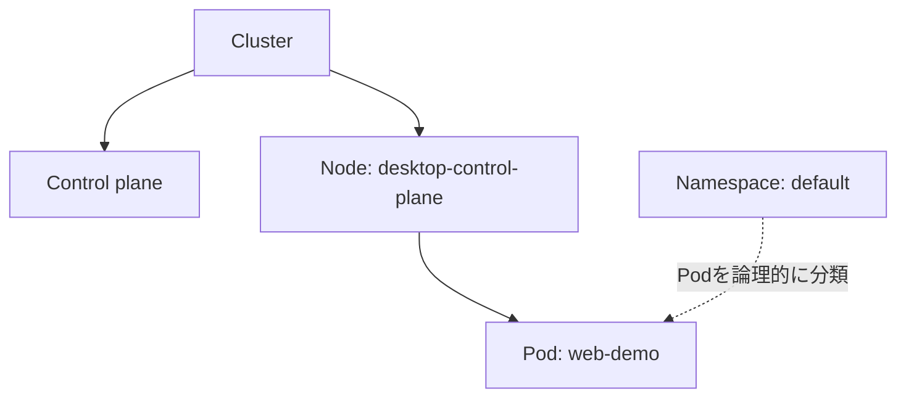

# Cluster・Node・Pod

## 概要

- **Cluster**: Kubernetesが管理する全体。Control planeと、Podを実行するNodeで構成される。
- **Node**: Podを実行するマシン。物理マシンや仮想マシンなど、クラスター構成に応じた実行環境を表す。
- **Pod**: Kubernetesが管理する実行単位。1個以上のコンテナをまとめて実行する。

## 今回のクラスター

Docker Desktop上に学習用クラスターを作成した。Node一覧は次のとおり。

```text
NAME                    STATUS   ROLES           AGE   VERSION
desktop-control-plane   Ready    control-plane   22h   v1.36.1
```

このクラスターではNodeが1台で、名前は`desktop-control-plane`。`control-plane`はNodeの役割ラベルで、Kubernetesクラスターを管理するControl plane側のNodeであることを示す。学習用の単一Nodeクラスターでは、アプリケーションPodもこのNode上で動く。

Docker Desktopのkind方式では、Nodeはコンテナ内に構成される。これは専用の物理サーバーやUbuntu VMを追加したという意味ではない。

## Podの実行確認

`web-demo` Deploymentが作成したPod:

```text
pod/web-demo-5df467d9c5-6f5x5   1/1   Running   1 (118s ago)   22h
```

Podは`Running`かつコンテナ`1/1`がReady。Docker Desktop終了後の再開確認時に再起動回数1が表示されたが、出力だけでは原因を特定できなかった。

## NamespaceとNodeの違い

Namespaceはクラスター内のKubernetesリソースを論理的に分ける区画。NodeはPodが実際に配置される実行マシンであり、NamespaceはNodeの内側にあるマシンではない。PodはNamespaceに属し、Node上で実行される。



## 確認コマンド

```bash
kubectl get nodes
kubectl get pods -o wide
```

`kubectl get pods -o wide`を使うと、Podの`NODE`列から配置先のNodeも確認できる。

## 次に学ぶこと

Namespaceを作成し、名前空間を指定したリソースの確認方法を学ぶ。
