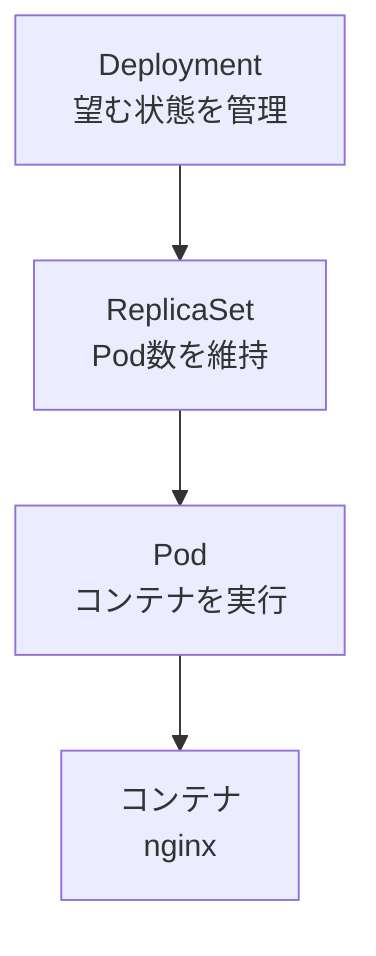

# Deployment

## 概要

DeploymentはアプリケーションのPod群を管理するKubernetesリソース。望むPod数などを宣言すると、Deploymentコントローラーが実際の状態をその状態に合わせる。

## 必要性

Podを直接作るだけだと、Podが消えたときに自分で作り直す必要がある。Deploymentを使うと、ReplicaSetを介して指定した数のPodを維持でき、更新やロールバックも管理できる。

## 仕組み



DeploymentがReplicaSetを作り、ReplicaSetが指定数のPodを作成・維持する。今回の作成コマンドではレプリカ数を指定していないため、既定の1 Podが作成された。

## 実習

### Deploymentを作成

```bash
kubectl create deployment web-demo --image=nginx:alpine
```

実行結果:

```text
deployment.apps/web-demo created
```

このコマンドは`default` NamespaceにDeploymentを作成する。Nginxイメージがローカルにない場合は、コンテナレジストリからダウンロードされる。

### Deployment・ReplicaSet・Podを確認

```bash
kubectl get deployments,replicasets,pods
```

実行結果:

```text
NAME                       READY   UP-TO-DATE   AVAILABLE   AGE
deployment.apps/web-demo   1/1     1            1           53s

NAME                                  DESIRED   CURRENT   READY   AGE
replicaset.apps/web-demo-5df467d9c5   1         1         1       53s

NAME                            READY   STATUS    RESTARTS   AGE
pod/web-demo-5df467d9c5-6f5x5   1/1     Running   0          53s
```

## 実行結果から分かったこと

- Deployment、ReplicaSet、Podがそれぞれ1つ作成された。
- Deploymentの`READY 1/1`は、望む1つのPodがReadyであることを示す。
- ReplicaSetの`DESIRED 1`と`CURRENT 1`は、望む数と現在のPod数が一致していることを示す。`READY 1`は準備できたPodが1つあることを示す。
- Podは`1/1 Running`で、Pod内のコンテナ1つが起動し、Readyになっている。`RESTARTS 0`は再起動がまだ発生していないことを示す。
- 名前の末尾にハッシュ風の文字列が付くのは、Deployment/ReplicaSetに紐づくPodを識別するため。Pod名は再作成時に変わることがある。

## 気づき

- `kubectl create deployment`への成功応答は、APIにDeployment作成要求が受理されたことを示す。Podの起動完了は、`kubectl get`で別途確認する。
- アプリケーションの実行状態を確認するときは、Deploymentだけでなく、その下のReplicaSetとPodも見ると、どの段階で止まっているかを追いやすい。
- Kubernetesでは通常、単独Podを直接管理するより、Deploymentなどのワークロードリソースを通じて管理する。

## 次に学ぶこと

Serviceを作成し、Podの名前やIPが変わってもアプリケーションへ安定して接続する方法を学ぶ。
